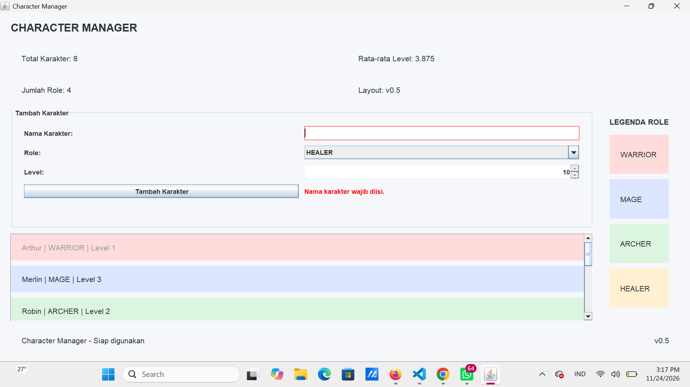
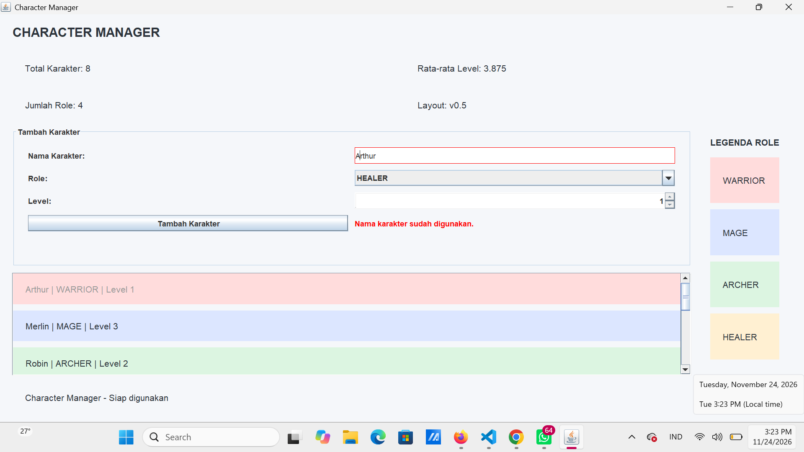
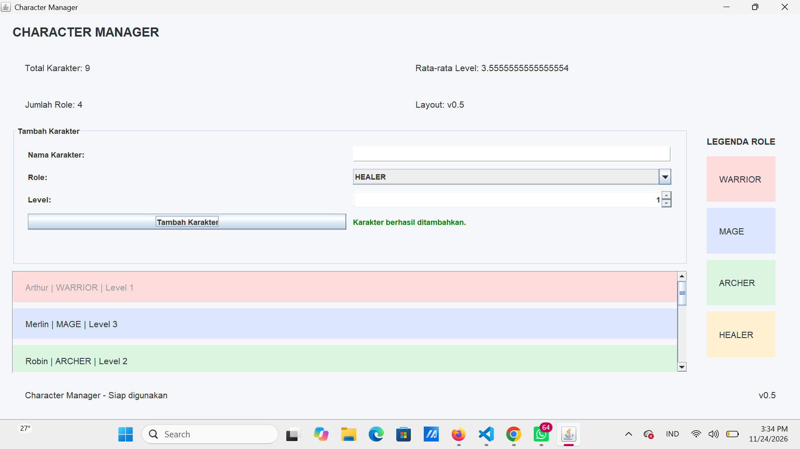

# Character Manager

Character Manager merupakan aplikasi desktop berbasis Java yang digunakan untuk mengelola data karakter. Project ini dibuat untuk memenuhi tugas mata kuliah Java Visual SIH-6406.

## Fitur Aplikasi

- Menambahkan karakter baru berdasarkan nama, role, dan level.
- Menampilkan daftar karakter dalam bentuk card.
- Menampilkan jumlah dan rata-rata level karakter.
- Membedakan warna card berdasarkan role karakter.
- Memeriksa nama agar tidak ada karakter dengan nama yang sama.
- Mencari dan menghapus karakter dari daftar.

## Struktur Project

```text
CharacterManager/
├── src/
│   └── com/unpri/charactermanager/
│       ├── Main.java
│       ├── model/
│       │   ├── Character.java
│       │   ├── CharacterManager.java
│       │   └── CharacterType.java
│       └── view/
│           ├── AppTheme.java
│           ├── CharacterFormPanel.java
│           └── MainWindow.java
├── bin/
├── screenshots/
└── README.md
```

## TP14 — Form dan Validasi Input

### A. Implementasi Form

Pada TP14, aplikasi Character Manager dilengkapi dengan form untuk menambahkan karakter. Form tersebut terdiri dari kolom nama menggunakan `JTextField`, pilihan role menggunakan `JComboBox`, dan pengaturan level menggunakan `JSpinner` dengan batas level 1 sampai 99.

Sebelum karakter ditambahkan, sistem akan memeriksa data yang dimasukkan. Pemeriksaan nama dilakukan mulai dari memastikan nama tidak kosong, memeriksa panjang nama, format penulisan, hingga memastikan nama belum digunakan. Jika terdapat kesalahan, pesan akan ditampilkan pada form agar pengguna mengetahui bagian yang perlu diperbaiki.

### B. Aturan Validasi Tambahan

Selain validasi utama, terdapat dua aturan tambahan yang diterapkan:

1. Nama karakter harus memiliki panjang minimal 3 dan maksimal 20 karakter. Pemeriksaan ini dilakukan pada View karena berhubungan langsung dengan data yang dimasukkan pengguna.
2. Nama hanya boleh menggunakan huruf dan satu spasi di antara kata. Aturan ini juga diperiksa pada View untuk mencegah penulisan nama yang tidak sesuai.

Pada bagian Model, terdapat aturan tambahan untuk role MAGE. Karakter dengan role MAGE hanya diperbolehkan memiliki level maksimal 60. Jika level yang dimasukkan melebihi batas tersebut, sistem akan menolak data dan menampilkan pesan kesalahan.

### C. Hasil Pengujian

Pengujian dilakukan dengan mencoba beberapa jenis input untuk memastikan validasi berjalan sesuai aturan.

| No. | Input | Hasil yang Diharapkan | Hasil Aktual | Lapisan |
|---|---|---|---|---|
| 1 | Nama kosong | Data ditolak | Pesan nama wajib diisi muncul | View |
| 2 | Arthur (nama sudah ada) | Data ditolak | Pesan nama sudah digunakan muncul | View |
| 3 | Al | Data ditolak karena terlalu pendek | Pesan batas 3–20 karakter muncul | View |
| 4 | Refalin123 | Data ditolak karena format tidak sesuai | Pesan format nama muncul | View |
| 5 | Refalin  Silaban | Data ditolak karena spasi berulang | Pesan format nama muncul | View |
| 6 | Gandalf, MAGE, level 61 | Data ditolak | Pesan batas level MAGE muncul | Model |
| 7 | Gandalf, MAGE, level 60 | Data diterima | Karakter berhasil ditambahkan | Model |
| 8 | `  Arwen  `, ARCHER, level 1 | Nama disimpan tanpa spasi di awal dan akhir | Karakter berhasil ditambahkan setelah trim | View |

### D. Screenshot

**1. Pengujian nama kosong**

Simpan gambar dengan nama `tp14-empty-name.png`.



**2. Pengujian nama duplikat**

Simpan gambar dengan nama `tp14-duplicate-name.png`.



**3. Penambahan karakter berhasil**

Simpan gambar dengan nama `tp14-success.png`.



### E. Catatan Implementasi

Pada TP14, penggunaan `ActionListener` masih dibuat secara sederhana untuk menjalankan proses ketika tombol tambah karakter ditekan. View juga masih memanggil `manager.addCharacter()` secara langsung untuk menambahkan data ke dalam daftar karakter. Cara ini digunakan agar form dapat berjalan sesuai kebutuhan tugas. Ke depannya, proses tersebut dapat dikembangkan dengan pemisahan tugas yang lebih jelas antara View, Model, dan bagian pengendali.

### F. Google Docs
https://docs.google.com/document/d/1KGDi9qdMg1q-IjtkEDKBklb1hnLLuM4SLbHvNAw4OGE/edit?usp=sharing