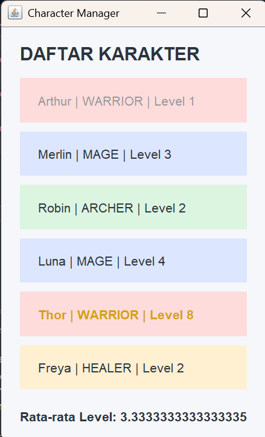

## TP10 – Character Manager AppTheme

### 1. Deskripsi

Pada TP10, program Character Manager mengalami pengembangan pada bagian tampilan. Pengembangan ini dilakukan dengan menambahkan class `AppTheme` untuk mengatur warna, font, dan border yang digunakan dalam aplikasi. Tujuannya agar pengaturan tampilan lebih rapi dan tidak semuanya ditulis langsung di dalam `MainWindow`.

### 2. Implementasi AppTheme

Class `AppTheme.java` berisi pengaturan tampilan yang digunakan pada aplikasi, mulai dari warna latar belakang, warna teks, warna kartu karakter, font, hingga border. Selain itu, terdapat method `colorFor()` yang digunakan untuk menentukan warna kartu berdasarkan role masing-masing karakter.

Dengan adanya class ini, pengaturan tampilan menjadi lebih terpusat sehingga jika ingin mengubah warna atau font, perubahan dapat dilakukan melalui `AppTheme` tanpa harus mengubah banyak bagian pada `MainWindow`.

### 3. Pengembangan MainWindow v0.4

Pada versi v0.4, tampilan `MainWindow` diperbarui dengan menggunakan pengaturan yang sudah dibuat di `AppTheme`. Setiap karakter ditampilkan dalam bentuk kartu dengan warna yang berbeda sesuai role-nya. Ukuran jendela juga menggunakan method `pack()` agar dapat menyesuaikan dengan komponen yang ditampilkan.

Selain itu, diterapkan aturan khusus untuk karakter yang memiliki level 5 atau lebih. Karakter tersebut akan ditampilkan dengan teks berwarna emas dan dicetak tebal. Batas level ini disimpan dalam konstanta `GOLD_LEVEL_THRESHOLD` agar lebih mudah digunakan dan diatur.

### 4. Properti Tambahan

Dalam pengembangan ini, terdapat dua properti tambahan yang diterapkan pada tampilan karakter, yaitu:

1. **Tooltip HP dan ATK**  
   Informasi HP dan ATK dapat dilihat ketika kursor diarahkan ke kartu karakter. Dengan begitu, informasi tambahan tetap bisa diketahui tanpa harus ditampilkan langsung pada bagian utama kartu.

2. **Karakter level 1 tidak aktif**  
   Label karakter yang memiliki level 1 dibuat tidak aktif menggunakan `setEnabled(false)`. Pengaturan ini digunakan untuk memberikan perbedaan tampilan pada karakter yang masih berada di level awal.

### 5. Screenshot

**Tampilan sebelum TP10 (v0.3)**

**Tampilan sesudah TP10 (v0.4)**

### 6. Pemisahan Model dan View

Pengaturan warna ditempatkan di `AppTheme` karena warna merupakan bagian dari tampilan aplikasi. Sementara itu, class `Character` tetap digunakan untuk menyimpan data karakter, seperti nama, tipe, level, HP, dan ATK.

Jika pengaturan warna dimasukkan ke dalam class `Character`, bagian pengelolaan data akan bercampur dengan pengaturan tampilan. Oleh karena itu, keduanya dipisahkan agar kode lebih mudah dipahami dan perubahan tampilan tidak perlu memengaruhi data karakter.

### 7. Analisis

Analisis TP10 membahas beberapa materi yang berkaitan dengan pengembangan aplikasi, yaitu penggunaan getter dan setter pada komponen Swing, perbedaan pengaturan ukuran komponen, penggunaan logical font, serta pemisahan tanggung jawab antara Model dan View.

**Link Google Docs:** https://docs.google.com/document/d/1MTaVMRqRkq_b48w2UDM5ZwUJF-1hyJLtUJbj9MpBVHE/edit?usp=sharing