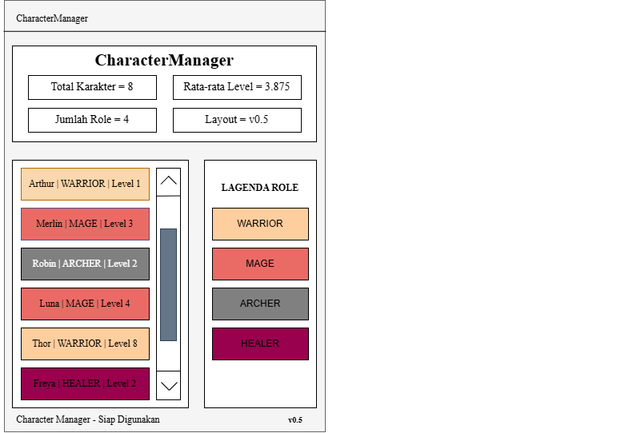
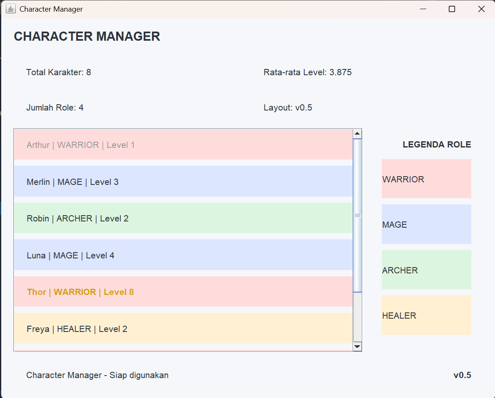
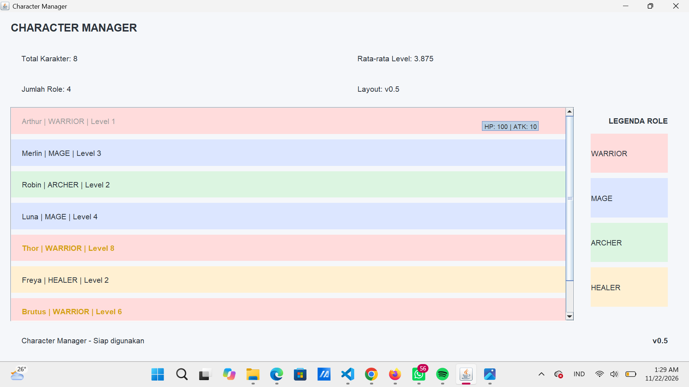
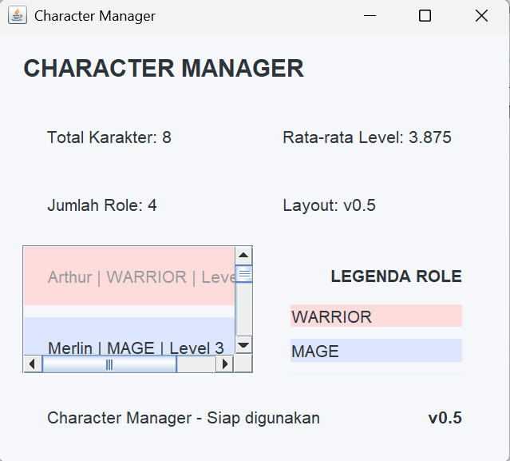

## TP12 — Responsive Character Manager Layout

### A. Deskripsi

Pada TP12, aplikasi Character Manager dikembangkan dengan mengatur ulang tampilan menggunakan Layout Manager pada Java Swing. Pengaturan ini dilakukan agar setiap bagian aplikasi memiliki posisi yang jelas dan tampilan tetap menyesuaikan ketika ukuran jendela berubah.

### B. Struktur Layout

Aplikasi menggunakan `BorderLayout` sebagai layout utama dengan pembagian sebagai berikut:

- **NORTH:** Menampilkan judul aplikasi dan panel statistik karakter.
- **CENTER:** Menampilkan daftar karakter di dalam `JScrollPane`.
- **EAST:** Menampilkan legenda jenis karakter menggunakan `BoxLayout`.
- **SOUTH:** Menampilkan informasi status aplikasi dan versi.

Panel daftar karakter dan panel legenda menggunakan `BoxLayout` agar komponennya tersusun secara vertikal. Sementara itu, panel statistik menggunakan `GridLayout(2,2)` untuk menyusun empat informasi dalam dua baris dan dua kolom.

### C. Wireframe

### D. Screenshot Tampilan Aplikasi

**1. Tampilan awal**

**2. Tampilan setelah diperlebar**

**3. Tampilan setelah dipersempit**

### E. Pengamatan Perubahan Ukuran Jendela

| Kondisi | Prediksi | Hasil Pengamatan |
|---|---|---|
| Ukuran awal | Semua bagian aplikasi terlihat dengan susunan yang rapi. | Komponen tampil sesuai dengan pembagian layout. |
| Jendela diperlebar | Ruang tampilan menjadi lebih luas dan komponen menyesuaikan posisinya. | Tampilan menjadi lebih lebar dan daftar karakter tetap terlihat. |
| Jendela dipersempit | Ruang daftar karakter berkurang dan scrollbar dapat digunakan untuk melihat isi lainnya. | Scrollbar muncul sehingga daftar karakter tetap dapat diakses. |

### F. Panel Tambahan dan Alasan Pemilihan Layout

Panel tambahan yang dibuat adalah panel statistik karakter pada bagian atas aplikasi. Panel ini menampilkan informasi seperti jumlah karakter dan rata-rata level. Layout yang digunakan adalah `GridLayout(2,2)` karena empat informasi dapat disusun dalam dua baris dan dua kolom dengan ukuran sel yang sama.

Layout yang tidak dipilih adalah `FlowLayout`. Layout tersebut lebih mengutamakan susunan komponen secara horizontal dan dapat berpindah baris ketika ruang tidak mencukupi. Untuk panel statistik ini, `GridLayout` lebih sesuai karena susunannya tetap teratur.

### G. Struktur Panel Bersarang

Aplikasi menggunakan beberapa panel yang disusun di dalam panel utama. Panel header berisi judul aplikasi dan panel statistik, sedangkan panel utama menampung header, daftar karakter, legenda, serta status bar. Daftar karakter ditempatkan dalam `JScrollPane` agar tetap dapat diakses ketika ukuran jendela diperkecil. Pembagian panel ini membuat setiap bagian memiliki fungsi masing-masing dan lebih mudah diatur.

### H. Kesimpulan

Penggunaan Layout Manager membantu membuat tampilan aplikasi lebih terstruktur dan menyesuaikan ukuran jendela. Dengan menggabungkan `BorderLayout`, `BoxLayout`, dan `GridLayout`, setiap komponen dapat ditempatkan sesuai fungsinya. Penggunaan `JScrollPane` juga membantu agar daftar karakter tetap dapat diakses ketika ruang tampilan terbatas.

### I. Link Google Docs 
https://docs.google.com/document/d/1yZoqGbUuq_spa8f3M1Poc093G7Sd08qHeh4ZmkI8SxA/edit?usp=sharing

