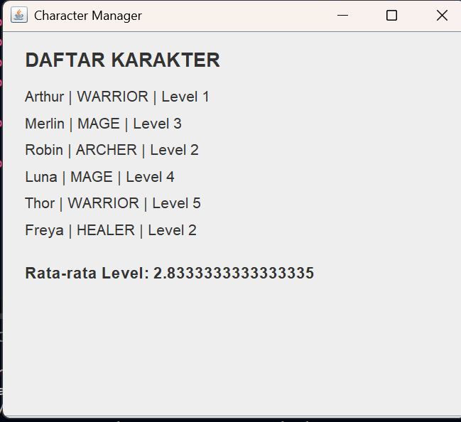
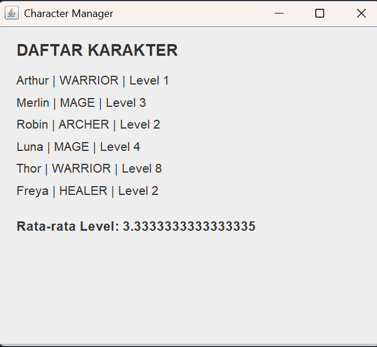

# TP8 – Character Manager GUI

## 1. Deskripsi

Pada TP8 ini, program Character Manager dikembangkan dari program berbasis console menjadi aplikasi dengan tampilan GUI menggunakan Java Swing. Melalui pengembangan ini, data karakter yang sebelumnya ditampilkan di terminal sekarang dapat dilihat melalui sebuah jendela aplikasi.

Selain menampilkan daftar karakter, program juga dilengkapi dengan informasi rata-rata level untuk mengetahui nilai rata-rata dari seluruh karakter yang tersedia.

## 2. Struktur Proyek

```text
CharacterManager/
├── src/
│   └── com/unpri/charactermanager/
│       ├── Main.java
│       ├── model/
│       │   ├── Character.java
│       │   ├── CharacterType.java
│       │   └── CharacterManager.java
│       └── view/
│           └── MainWindow.java
├── bin/
├── outputtp8-1.png
├── outputtp8-2.png
└── README.md
```

## 3. Implementasi GUI

Pada bagian ini dibuat class `MainWindow.java` di dalam package `view`. Class tersebut menggunakan `JFrame` sebagai jendela utama untuk menampilkan daftar karakter.

Data karakter diambil dari `CharacterManager`, kemudian ditampilkan menggunakan perulangan. Dengan demikian, setiap karakter yang tersimpan dapat ditampilkan tanpa harus membuat JLabel secara manual untuk masing-masing karakter.

Program juga menggunakan `SwingUtilities.invokeLater()` agar proses pembuatan dan penampilan GUI dijalankan melalui Event Dispatch Thread.

## 4. Penambahan Karakter

Pada pengembangan ini terdapat dua karakter tambahan, yaitu:

- **Thor** dengan tipe WARRIOR dan level 8. Karakter ini ditambahkan untuk memberikan variasi level yang lebih tinggi.
- **Freya** dengan tipe HEALER dan level 2. Karakter ini ditambahkan agar daftar karakter memiliki tipe yang lebih beragam.

Dengan penambahan tersebut, jumlah karakter yang ditampilkan menjadi enam karakter.

## 5. Mini-Challenge: Rata-rata Level

Fitur rata-rata level ditampilkan di bagian bawah daftar karakter. Perhitungannya menggunakan method `getAverageLevel()` yang sudah dibuat pada `CharacterManager`.

Untuk menguji fitur ini, level Thor diubah dari level 5 menjadi level 8. Setelah program dijalankan kembali, nilai rata-rata level ikut berubah dari 2,83 menjadi 3,33.

## 6. Screenshot Output

Berikut adalah hasil tampilan program sebelum dan sesudah perubahan data karakter.

**Sebelum perubahan data**



**Sesudah perubahan data**



## 7. Alur Data dan MVC

Data karakter dibuat di `Main.java` dengan bantuan `CharacterManager`. Setelah itu, data tersebut diberikan kepada `MainWindow` untuk ditampilkan pada jendela aplikasi.

Dalam penerapan MVC, class `Character` dan `CharacterManager` berperan sebagai Model yang mengelola data. Sementara itu, `MainWindow` berperan sebagai View yang menampilkan data kepada pengguna. `Main.java` menjadi bagian yang menghubungkan keduanya saat program dijalankan.

## 8. Analisis

**Link Google Docs:** https://docs.google.com/document/d/19DkADBYzsJm1pFf_WcYkgb2wItTcyEMFdeVkQOd_p28/edit?usp=sharing

## 9. Kesimpulan

Melalui TP8, program Character Manager berhasil dikembangkan menjadi aplikasi GUI menggunakan Java Swing. Program sudah dapat menampilkan enam karakter secara dinamis dan menghitung rata-rata level berdasarkan data yang tersedia. Dari pengembangan ini, saya juga mempelajari hubungan antara Model dan View serta cara menjalankan aplikasi GUI menggunakan Swing.