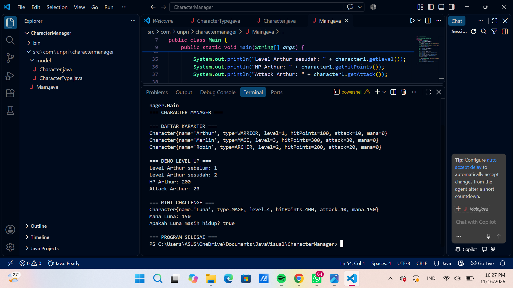
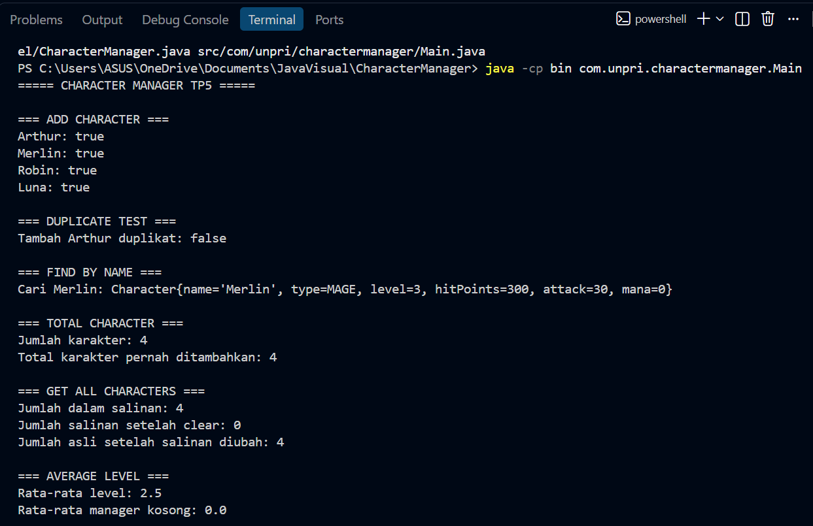
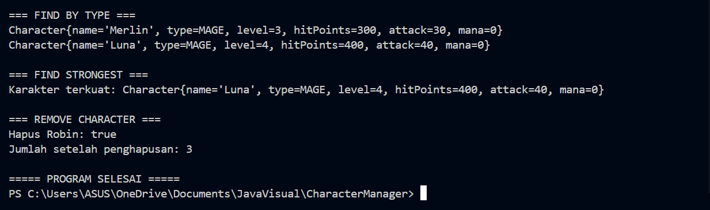

# Character Manager — TP3 

## Deskripsi
Character Manager merupakan program sederhana berbasis Java untuk mengelola data karakter dalam sebuah game. Program ini menerapkan konsep Object-Oriented Programming (OOP), seperti encapsulation, constructor, getter, setter, dan enum.

Pada tugas ini, program dikembangkan dengan menambahkan atribut mana dan method isAlive() untuk mengetahui kondisi karakter berdasarkan jumlah HP.

## Fitur Program
- Membuat karakter menggunakan dua constructor.
- Menggunakan enum CharacterType untuk menentukan jenis karakter.
- Mengatur level, HP, dan attack karakter.
- Menambahkan atribut mana dengan validasi nilai.
- Mengecek kondisi karakter menggunakan method isAlive().
- Menampilkan informasi karakter melalui toString().

## Struktur Folder

```text
CharacterManager/
│
├── src/
│   └── com/
│       └── unpri/
│           └── charactermanager/
│               ├── Main.java
│               └── model/
│                   ├── Character.java
│                   └── CharacterType.java
│
├── bin/
│
├── screenshots/
│   └── output.png
│
└── README.md
```

## Screenshot Output



Screenshot menunjukkan hasil program yang berhasil dijalankan, termasuk daftar karakter, demo level up, penggunaan mana, dan hasil pengecekan isAlive().

## Identitas Mahasiswa

- Nama: Refalin E.T Silaban
- NIM: 253303621265
- Mata Kuliah: Java Visual 

## Dokumentasi Analisis Desain

Link Google Docs: https://docs.google.com/document/d/1oBb56zuPdNNHZe6EV0b_abqxww5cIXs-dns3gTZaIV0/edit?usp=sharing


## TP5 – Character Manager

### 1. Deskripsi

Pada tugas TP5 ini, program Character Manager dikembangkan dengan menambahkan beberapa fungsi untuk mengelola data karakter. Pengembangan dilakukan menggunakan ArrayList sebagai tempat penyimpanan data karakter.

Selain menambahkan fungsi pengelolaan data, tugas ini juga menerapkan perbandingan objek menggunakan `equals()`, pengujian nama duplikat, serta penggunaan reference pada objek Java.

### 2. Struktur Proyek

```text
CharacterManager/
├── src/
│   └── com/unpri/charactermanager/
│       ├── Main.java
│       └── model/
│           ├── Character.java
│           ├── CharacterType.java
│           └── CharacterManager.java
├── bin/
├── outputtp3.png
├── outputtp5.png
└── README.md
```

### 3. Implementasi Program

Beberapa fungsi yang ditambahkan dan dikembangkan pada TP5 antara lain:

**Bagian A – Implementasi Core**

- `equals()` digunakan untuk membandingkan dua karakter berdasarkan nama.
- `addCharacter()` digunakan untuk menambahkan karakter ke dalam daftar.
- `findByName()` digunakan untuk mencari karakter berdasarkan nama.
- `removeCharacter()` digunakan untuk menghapus karakter.
- `getTotalCharacters()` digunakan untuk mengetahui jumlah karakter.
- `getAllCharacters()` digunakan untuk mendapatkan salinan daftar karakter tanpa mengubah daftar aslinya.

**Bagian B – Mini-Challenge**

- `getAverageLevel()` digunakan untuk menghitung rata-rata level karakter. Jika belum ada karakter, hasilnya adalah 0.
- `findByType()` digunakan untuk mencari karakter berdasarkan tipe yang dipilih.

**Bagian C – Fitur Tambahan**

Method tambahan yang dibuat adalah `findStrongest()`. Method ini digunakan untuk mencari karakter dengan nilai attack paling tinggi dari seluruh karakter yang tersimpan.

Pencarian dilakukan dengan membandingkan nilai attack setiap karakter. Jika daftar karakter masih kosong, method akan mengembalikan `null`.

### 4. Pengujian Program

Pengujian dilakukan melalui `Main.java` untuk memastikan setiap fungsi dapat berjalan dengan baik. Pengujian meliputi penambahan karakter, penolakan nama duplikat, pencarian dan penghapusan karakter, perhitungan rata-rata level, serta pencarian berdasarkan tipe.

Selain itu, dilakukan pengujian salinan ArrayList dengan menghapus isi daftar salinan untuk memastikan daftar karakter asli tidak ikut berubah.

### 5. Screenshot Output

Berikut merupakan hasil pengujian program Character Manager TP5.





### 6. Analisis

Pembahasan mengenai reference, primitive value, penggunaan `static`, method `equals()`, dan Encapsulation ditulis dalam dokumen terpisah.

**Link Google Docs:** https://docs.google.com/document/d/1hDeDd1LbydfVmSO68xuhlgy8NQ0NPCIgeXcDf-wmU8E/edit?usp=sharing

